## `> cat sobre.txt`

Sou o **Raphael**, estudante de **Análise e Desenvolvimento de Sistemas no Senac**, em São Paulo. Meu foco é **desenvolvimento backend com Java e Spring Boot**: gosto de construir APIs REST organizadas em camadas, com validação, tratamento de erros, segurança e testes automatizados.

`[+]` Buscando minha **primeira oportunidade** como estagiário ou Desenvolvedor Java Júnior 
`[+]` Estudando agora: Spring Security com JWT, testes com JUnit e Mockito, Docker e deploy na AWS 
`[+]` Aprendo melhor resolvendo problemas reais — cada projeto aqui nasceu de um 
`[+]` São Paulo, SP

## `> ls ./stack`

  

## `> ls ./projetos`

### `[✔]` Concluídos

#### [gestao-de-clinica](https://github.com/Dev-RP7/gestao-de-clinica) — API REST

-D97757?style=for-the-badge&logo=claude&logoColor=white&labelColor=0a0e13)

API para uma clínica médica: usuários, médicos, pacientes, especialidades, consultas, prontuários e receitas. Desenvolvida com o auxílio da IA **Claude**, da Anthropic.

- Autenticação **JWT** e controle de acesso por perfil com Spring Security
- Paginação, filtros, relatórios e erros padronizados com `GlobalExceptionHandler`
- **27 testes** com JUnit 5, Mockito e MockMvc (unidade, repositório e integração)
- Sobe com um único comando via **Docker Compose** (API + MySQL), documentada no **Swagger**

`Java 25` · `Spring Boot 4` · `Spring Security` · `MySQL` · `H2` · `Docker`

| Projeto | O que é | Stack |
| --- | --- | --- |
| [sorts-em-java](https://github.com/Dev-RP7/Sorts-em-Java) | Bubble, Insertion, Selection e Quick Sort, com medição do tempo de execução e análise de complexidade | `Java 25` |
| [pilha-em-java](https://github.com/Dev-RP7/AulaEstruturaDeDadosPilha) | Estrutura de dados Pilha (LIFO) genérica, com herança e redimensionamento de array | `Java 25` · `Generics` |

### `[~]` Em andamento

#### [locadora-de-jogos](https://github.com/Dev-RP7/locadora-de-jogos) — API REST

API para aluguel de jogos, com cadastro de jogos por console, usuários e aluguéis.

- Rotina agendada com `@Scheduled` que expira aluguéis vencidos automaticamente
- Conversão entre entidades e DTOs com **MapStruct**
- MySQL na aplicação e H2 nos testes, com Dockerfile para empacotar a API

`Java 25` · `Spring Boot` · `Spring Security` · `MapStruct` · `MySQL`

| Projeto | O que é | Stack |
| --- | --- | --- |
| [gerenciamento-de-biblioteca](https://github.com/Dev-RP7/Gerenciamento-de-Biblioteca) | API de livros, clientes e vendas, com DTOs de entrada e saída e camadas controller → service → repository | `Java 25` · `Spring Boot` · `JPA` |
| [bar-poo](https://github.com/Dev-RP7/projeto-Bar-POO) | Modelagem orientada a objetos de um sistema de pedidos de bar (bebidas, lanches, itens e formas de pagamento) com interface em JavaFX | `Java 25` · `JavaFX` · `Lombok` |
| [aulas-senac](https://github.com/Dev-RP7/Aulas-Senac) | Primeiros passos com Spring Boot: projeto de farmácia e configuração de fuso horário | `Java 25` · `Spring Boot` |

## `> cat stats.log`

  
  
   
  

<!--
## `> ./contato.sh`

-->

<code>[+] obrigado pela visita · conexão encerrada</code>

